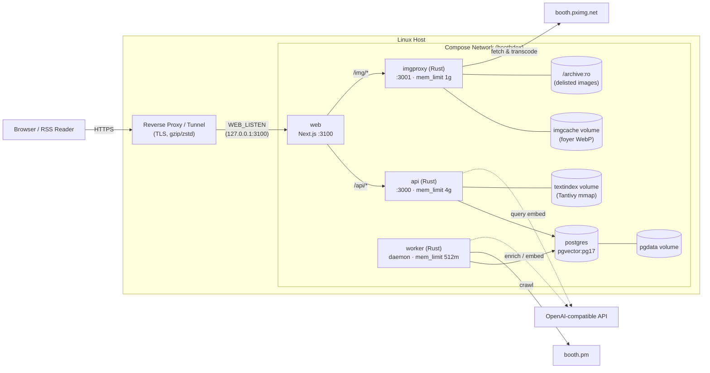
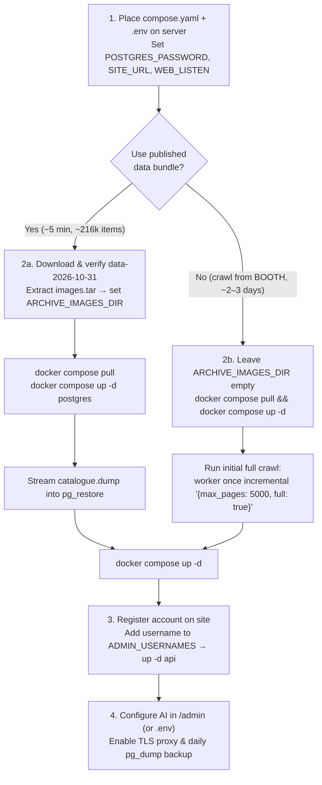
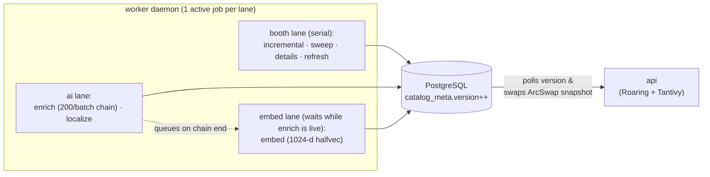

# Deploying to a Linux server

Everything runs in containers: PostgreSQL 17 (`pgvector`), the three Rust services (`api`, `worker`, `imgproxy`) and the Next.js site (`web`). Only `web` publishes a host port (`WEB_LISTEN`, default `3100`) and forwards `/api/*` and `/img/*` over the internal Compose network. Put your own TLS reverse proxy or tunnel (Caddy, nginx, Cloudflare Tunnel) in front of it.



`postgres`, `api`, `worker` and `imgproxy` publish no host ports; run maintenance commands through `docker compose exec` (for example `docker compose exec postgres psql -U catalogue catalogue`). `podman compose` works with the same commands.

## Deployment overview



## 1. Server requirements

| Resource | Minimum | Recommended | Why |
|---|---|---|---|
| RAM | **6 GB** (or 4 GB + 4 GB swap) | **8 GB** | On Linux, `api` uses ~1.3–2.4 GB steady (including the memory-mapped Tantivy index) and peaks at ~2.5–3 GB while hot-reloading a new catalogue (`mem_limit: 4g`); `postgres` ~1 GB; `imgproxy` up to 1 GB; `worker` <512 MB; `web` ~200 MB |
| CPU | 2 vCPU | 4 vCPU | WebP transcoding and Tantivy index rebuilds are CPU-bound |
| Disk | 40 GB SSD | 60 GB+ SSD | Database ~3 GB (~4 GB with embeddings), archived images ~1 GB, `imgcache` 10 GB (configurable), container images and backups |
| OS | Linux with Docker or Podman (+ Compose) | — | Prebuilt `linux/amd64` images are published to `ghcr.io` |

## 2. Get the stack files (and optional data bundle)

### Prebuilt images (recommended)

No Git checkout or compiler is required when pulling images from `ghcr.io` — only `compose.yaml` and `.env`:

```sh
mkdir -p /srv/boothdex && cd /srv/boothdex
curl -fLO https://raw.githubusercontent.com/JohnsonRan/BoothDex/master/deploy/compose.yaml
curl -fLo .env https://raw.githubusercontent.com/JohnsonRan/BoothDex/master/deploy/.env.example
```

To build from source instead (for example on `arm64` or with local changes):

```sh
git clone https://github.com/JohnsonRan/BoothDex.git /srv/boothdex/app
cd /srv/boothdex/app/deploy
cp .env.example .env
```

### Optional: download the data bundle

Without a data bundle, skip to [3. Configure](#3-configure) and follow [Starting without a data bundle](#starting-without-a-data-bundle) in step 4.

A data bundle is a snapshot of an existing instance created with `scripts/make-bundle.sh <out-dir>`. A ready-made bundle is published as the GitHub release [data-2026-10-31](https://github.com/JohnsonRan/BoothDex/releases/tag/data-2026-10-31): 215,911 items from the VRCatalogue archive plus that day's BOOTH crawl (browser mirror: [Filen](https://app.filen.io/#/f/f910e157-1651-42f4-8516-116b7af17c83%236d4a646241516c595a43473546664533504c5a664d4e4c4f7a4d4b48636a745f)). Services apply newer migrations automatically at startup, and the hourly crawl catches up from there.

| File | Contents | Size |
|---|---|---|
| `catalogue.dump` | PostgreSQL custom-format dump: all items, crawled BOOTH image links, taxonomy and schema. **No user accounts, sessions, favourites, viewed history, job history or AI settings.** | ~0.5–1 GB |
| `images.tar` | Archived WebP images of delisted items (`images/<sha1>.webp`) no longer served by BOOTH | ~1 GB |
| `SHA256SUMS` | SHA-256 checksums | — |

```sh
mkdir -p /srv/boothdex/bundle && cd /srv/boothdex/bundle
for f in catalogue.dump images.tar SHA256SUMS; do
  curl -fLO https://github.com/JohnsonRan/BoothDex/releases/download/data-2026-10-31/$f
done
sha256sum -c SHA256SUMS
tar -xf images.tar -C /srv/boothdex    # extracts to /srv/boothdex/images/*.webp
```

> `crates/importer` is only for raw VRCatalogue JSON archives (`items/`, `avatars/`, `dict/`, `labels/`); it is not used with `catalogue.dump`.

## 3. Configure

Edit `.env` in the directory holding `compose.yaml` (`/srv/boothdex/.env` or `/srv/boothdex/app/deploy/.env`):

```sh
$EDITOR .env    # set POSTGRES_PASSWORD, SITE_URL, WEB_LISTEN, and (with a bundle) ARCHIVE_IMAGES_DIR
```

| Variable | Used by | Notes |
|---|---|---|
| `WEB_LISTEN` | `web` | Host `[address:]port` for the site; set `127.0.0.1:3100` when the reverse proxy runs on the same host |
| `SITE_URL` | `api`, `web` | Public HTTP(S) origin without a path, e.g. `https://boothdex.example.com`; used in RSS links, canonical/share URLs, `robots.txt` and `sitemap.xml`. Read at runtime, so changing domains needs no image rebuild |
| `COOKIE_SECURE` | `api` | `1` (default): session cookies over HTTPS only. Set `0` only while testing over plain `http://` |
| `POSTGRES_PASSWORD` | `postgres`, `api`, `worker` | Long random secret, e.g. `openssl rand -base64 32` |
| `ADMIN_USERNAMES` | `api` | Comma-separated usernames synced at every `api` start (unlisted accounts lose admin) |
| `ARCHIVE_IMAGES_DIR` | `imgproxy` | `/srv/boothdex/images` when using a data bundle; leave empty without a bundle (uses an empty volume) |
| `IMG_CACHE_DISK_MB` / `IMG_CACHE_MEM_MB` | `imgproxy` | Transcoded WebP cache budget (`10240` MB disk / `256` MB RAM by default) |
| `BOOTHDEX_TAG` | `api`, `worker`, `imgproxy`, `web` | Image tag on `ghcr.io`: `latest` (default, tracks `master`), `0.1.0`, or `sha-<commit>` |
| `AI_API_KEY` / `AI_BASE_URL` / `AI_MODEL` / `AI_REASONING_EFFORT` / `AI_EMBED_MODEL` | `api`, `worker` | Optional; override and lock the `/admin` AI settings so API keys stay out of PostgreSQL |

Set automatically by `compose.yaml` (not needed in `.env`): `DATABASE_URL`, `PGPASSWORD` (passed separately so `/` `+` `=` in base64 passwords never break URL parsing), `IMGPROXY_URL` and `BIND`.

## 4. First start

Run from the directory containing `compose.yaml` and `.env`:

```sh
docker compose pull                       # or `docker compose build` from a source checkout
docker compose up -d postgres

# With a data bundle only — stream the dump straight into Postgres:
docker compose exec -T postgres pg_restore -U catalogue -d catalogue --no-owner --role=catalogue \
  < /srv/boothdex/bundle/catalogue.dump

docker compose up -d                      # api runs pending migrations, then loads the catalogue (~20 s)
docker compose logs -f api                # wait for "listening on"
```

Then complete onboarding:

1. Open the site (via your reverse proxy, or `http://<server>:3100` with `COOKIE_SECURE=0` for a quick check) and register your account.
2. Add that username to `ADMIN_USERNAMES` in `.env`, then run `docker compose up -d api`.
3. Open `/admin`: verify `worker` shows as running. Both the hourly incremental crawl and the daily full sweep (03:00 JST) are enabled by default.
4. Configure the AI provider in `/admin` (and click **Test**) or via `AI_*` in `.env`.

### Worker job lanes & catalogue reload

The worker groups jobs into three independent lanes so polite serial BOOTH crawling never blocks AI enrichment or embedding:



### Starting without a data bundle

Database migrations seed the category tree, smart tags and ~380 avatar bodies automatically. Populate items with one full crawl of BOOTH's `VRChat` tag listing (~3,400 pages, one item request per unknown item at ~0.7 s pacing — expect 2–3 days for ~200k items so BOOTH is not overloaded):

```sh
docker compose exec worker worker once incremental '{"max_pages": 5000, "full": true}'
# If interrupted, resume from the page shown in /admin (backing up a few pages is safe):
docker compose exec worker worker once incremental '{"max_pages": 5000, "full": true, "start_page": 1200}'
```

The site is usable while the crawl runs (`api` reloads automatically as items arrive). Newly crawled items receive AI categories, avatar-fit links and 4-language title translations once `enrich` processes them (200 items per batch, chaining itself until the backlog is empty). Before enabling AI on a 200k-item backlog, check your provider's token pricing: pausing the schedule does not stop an already-running chain — cancel the active or queued `enrich` job in `/admin` to halt immediately.

### Semantic search (optional)

Set an embeddings model in `/admin` (or `AI_EMBED_MODEL`), served by the same OpenAI-compatible provider. The model must return 1024-dimension vectors via the `dimensions` parameter (for example `Qwen3-Embedding-4B`; `/admin`'s connection test verifies this).

- **Indexing**: The hourly `embed` job embeds items missing a vector (~70 items/s during development, ~1 hour and a few dollars for ~200k items on `Qwen3-Embedding-4B` at $0.02/M tokens), then only processes new or edited items. Whenever an `enrich` chain finishes, it immediately queues `embed` so enriched items pick up translated English titles without waiting for the hourly tick.
- **Query caching & fallback**: Each unseen query string makes one provider call (median 0.7 s, p95 1.2 s in development) and caches the vector in memory and in `query_embeddings` (text only, no user/session data; pruned after 90 days unused, capped at 50,000 entries). Repeat searches take milliseconds. If the provider exceeds 2.5 s or errors, `/api/search` falls back to keyword search alone and surfaces a notice above results. Vectors add ~0.5 GB in PostgreSQL plus ~0.5 GB for the HNSW index.

## 5. Putting a proxy in front

Forward all traffic for your domain to `WEB_LISTEN`. Example with Caddy on the same host (`WEB_LISTEN=127.0.0.1:3100`):

```caddyfile
boothdex.example.com {
	encode zstd gzip
	reverse_proxy 127.0.0.1:3100 {
		flush_interval -1
	}
}
```

- **Server-sent events (`/api/admin/stream`)**: Disable response buffering so `/admin` updates live (`flush_interval -1` in Caddy, `proxy_buffering off;` in nginx).
- **Compression**: Next.js (`web`) enables gzip by default, and `api` compresses responses while excluding SSE. SSE responses carry `Cache-Control: no-transform` to avoid intermediary gzip buffering; front proxies can compress unencoded responses (`encode zstd gzip` in Caddy, `gzip on;` in nginx).
- **Host firewall & rate limiting**: Docker bypasses `ufw` when publishing `0.0.0.0:3100`, and `api`'s public read endpoints key their per-IP rate limits on `X-Forwarded-For` / `CF-Connecting-IP` from the front proxy. The front proxy must set or append `X-Forwarded-For` to the verified client IP (Caddy's `reverse_proxy` does this automatically; nginx needs `proxy_set_header X-Forwarded-For $proxy_add_x_forwarded_for;`); configuring only `X-Real-IP` without sanitizing incoming `X-Forwarded-For` allows visitors to forge their rate-limit identity. Bind `WEB_LISTEN=127.0.0.1:3100` whenever the proxy or tunnel runs on the same machine so visitors cannot bypass the proxy.
- **Cloudflare**: `/img/*` responses carry `Cache-Control: public, max-age=31536000, immutable` and are cached automatically. Keep **Rocket Loader** and HTML minification off so Next.js hydration is not broken.

## 6. Operations

| Task | Command |
|---|---|
| Update (prebuilt) | `docker compose pull && docker compose up -d` |
| Update (from source) | `git pull && docker compose up -d --build` |
| Tail logs | `docker compose logs -f api worker` |
| Restart one service | `docker compose restart worker` |
| Backup database | `docker compose exec -T postgres pg_dump -U catalogue -Fc catalogue > backup-$(date +%F).dump` (schedule daily, keep off-server) |
| Backup archived images | Copy `/srv/boothdex/images` once (changes only if you archive newly delisted items) |
| Restore database | `docker compose stop api worker && docker compose exec -T postgres pg_restore -U catalogue -d catalogue --clean --if-exists --no-owner --role=catalogue < backup.dump && docker compose start api worker` |

Safe to lose (rebuilt automatically): `imgcache` (re-fetched from BOOTH on demand) and `textindex` (rebuilt by `api` at startup in ~10 s).

## 7. Go-live checklist

- [ ] `.env` configured; `POSTGRES_PASSWORD` is a random secret (not `dev`)
- [ ] `WEB_LISTEN` bound to `127.0.0.1:3100` behind your TLS proxy, with `COOKIE_SECURE=1`
- [ ] `ADMIN_USERNAMES` lists only your account
- [ ] `https://<domain>/api/categories` returns JSON; `/img/v/<sha1>.webp` serves an archived image (if using a bundle)
- [ ] `/robots.txt` points to `/sitemap.xml` on your public domain; the sitemap lists only the homepage. Submit it to your search engine's webmaster tools. Search/filter/item-modal URLs use `noindex`; `/admin` and `/api/` are excluded from crawling (not an access-control mechanism)
- [ ] `/admin` shows `worker` online and a succeeded `incremental` job within an hour
- [ ] Off-server daily `pg_dump` backup is scheduled
- [ ] AI provider is configured (otherwise newly crawled items lack smart categories, avatar-fit links and translated titles)

## 8. Local development

See [`README.md`](../README.md#development) (`scripts/dev-up.sh`, `scripts/dev-down.sh`, `scripts/dev-restart.sh`). The dev scripts use a local `dev` password and are never used in production deployments.
