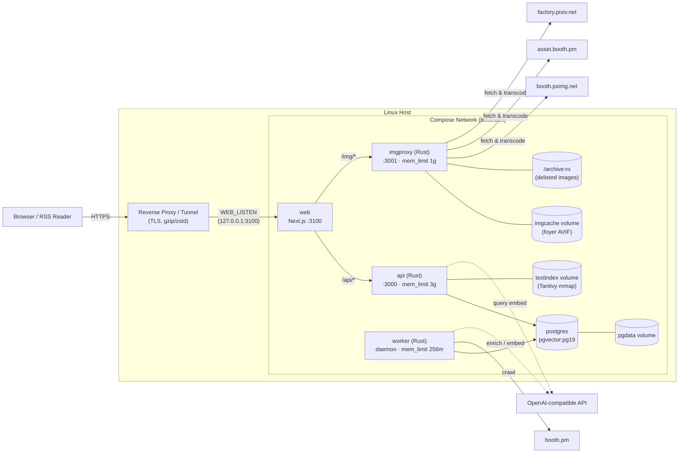
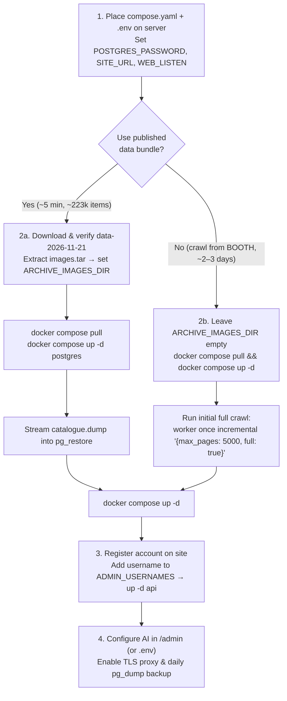

# Deploying to a Linux server

Everything runs in containers: PostgreSQL 19 (`pgvector`), the three Rust services (`api`, `worker`, `imgproxy`) and the Next.js site (`web`). Only `web` publishes a host port (`WEB_LISTEN`, default `127.0.0.1:3100`) and forwards `/api/*` and `/img/*` over the internal Compose network. Put your own TLS reverse proxy or tunnel (Caddy, nginx, Cloudflare Tunnel) in front of it.



`postgres`, `api`, `worker` and `imgproxy` publish no host ports; run maintenance commands through `docker compose exec` (for example `docker compose exec postgres psql -U catalogue catalogue`). `podman compose` works with the same commands.

Run exactly one `api` container; do not scale it ([why](SERVICES.md#one-api-container)). How `imgproxy`, the rate limits and Turnstile behave is in [Service behaviour](SERVICES.md).

## Deployment overview



## 1. Server requirements

| Resource | Minimum | Recommended | Why |
|---|---|---|---|
| RAM | **4 GB** + 2 GB swap | **6 GB** | 6 GB keeps the catalogue reload peak and the caches in RAM. Per-container figures: [Measurements](MEASUREMENTS.md#production-by-container) |
| CPU | 2 vCPU | 4 vCPU | AVIF transcoding and Tantivy index rebuilds are CPU-bound |
| Disk | 40 GB SSD | 60 GB+ SSD | Database ~3 GB (~4 GB with embeddings), archived images ~1 GB, `imgcache` 10 GB (configurable), container images and backups |
| OS | `linux/amd64` or `linux/arm64` with Docker or Podman (+ Compose) | — | Compose pulls the image for the host architecture |

## 2. Get the stack files (and optional data bundle)

### Prebuilt images (recommended)

No Git checkout or compiler is required when pulling images from `ghcr.io`, only `compose.yaml` and `.env`:

```sh
mkdir -p /srv/boothdex && cd /srv/boothdex
curl -fLO https://raw.githubusercontent.com/JohnsonRan/BoothDex/master/deploy/compose.yaml
curl -fLo .env https://raw.githubusercontent.com/JohnsonRan/BoothDex/master/deploy/.env.example
```

On ARM64, use `latest` or a `sha-` tag published with ARM64 support. Older `sha-` tags may only contain AMD64 images.
To build from source instead (for example, with local changes):

```sh
git clone https://github.com/JohnsonRan/BoothDex.git /srv/boothdex/app
cd /srv/boothdex/app/deploy
cp .env.example .env
```

### Optional: download the data bundle

Without a data bundle, skip to [3. Configure](#3-configure) and follow [Starting without a data bundle](#starting-without-a-data-bundle) in step 4.

A data bundle is a snapshot of an existing instance created with `scripts/make-bundle.sh <out-dir>`. A ready-made bundle is published as the GitHub release [data-2026-11-21](https://github.com/JohnsonRan/BoothDex/releases/tag/data-2026-11-21): 223,259 items (VRCatalogue archive plus BOOTH crawls up to that day), with semantic-search vectors from `Qwen/Qwen3-Embedding-4B`. It needs images from 2026-11-21 or later: an older `api` refuses a database with migrations it does not know.

- Services apply newer migrations automatically at startup, and the hourly crawl catches up from there.
- A bundle carries its instance's BOOTH tag dictionary and title translations: data-2026-11-21 has 31,775 translated tags and a Chinese title on every item. The daily `localize` job translates tags added after the snapshot.
- Job schedules come from the instance the bundle was made from: in data-2026-11-21 every job is on, `refresh` included. Change them in the admin console after the restore.
- If you configure a different embeddings model, clear the bundled vectors once so the `embed` job rebuilds them with yours: `docker compose exec postgres psql -U catalogue catalogue -c 'update items set embedding = null'`.

| File | Contents | Size |
|---|---|---|
| `catalogue.dump` | PostgreSQL custom-format dump: all items, crawled BOOTH image links, taxonomy, avatars, the tag dictionary and schema. **No user accounts, sessions, favourites, viewed history, job history, AI settings or guestbook messages.** | ~1.2 GB |
| `images.tar` | Archived WebP images of delisted items (`images/<sha1>.webp`) no longer served by BOOTH | ~1 GB |
| `SHA256SUMS` | SHA-256 checksums | — |

```sh
mkdir -p /srv/boothdex/bundle && cd /srv/boothdex/bundle
for f in catalogue.dump images.tar SHA256SUMS; do
  curl -fLO https://github.com/JohnsonRan/BoothDex/releases/download/data-2026-11-21/$f
done
sha256sum -c SHA256SUMS
tar -xf images.tar -C /srv/boothdex    # extracts to /srv/boothdex/images/*.webp
```

## 3. Configure

Edit `.env` in the directory holding `compose.yaml` (`/srv/boothdex/.env` or `/srv/boothdex/app/deploy/.env`):

```sh
$EDITOR .env    # set POSTGRES_PASSWORD, SITE_URL, WEB_LISTEN, CONTACT_EMAIL, and (with a bundle) ARCHIVE_IMAGES_DIR
```

| Variable | Used by | Notes |
|---|---|---|
| `WEB_LISTEN` | `web` | Host `[address:]port` for the site. Default `127.0.0.1:3100`: only a reverse proxy or tunnel on the same host reaches it. Set a bare port such as `3100` (all interfaces) only when the proxy runs on another machine, and restrict that port to the proxy with a firewall |
| `SITE_URL` | `api`, `web` | Public HTTP(S) origin without a path, e.g. `https://boothdex.example.com`; used in RSS links, canonical/share URLs, `robots.txt` and `sitemap.xml`. Read at runtime, so changing domains needs no image rebuild |
| `OPERATOR_NAME` | `web` | Who runs the site, as named in `/privacy` and `/terms`; defaults to the `SITE_URL` host |
| `CONTACT_EMAIL` | `web` | Contact address shown in `/privacy` and `/terms` for data, account deletion and takedown requests. Set it before opening registration; without it the pages show a placeholder |
| `COOKIE_SECURE` | `api` | `1` (default): session cookies and the stricter limits' `pass` cookie over HTTPS only. Set `0` only while testing over plain `http://` |
| `POSTGRES_PASSWORD` | `postgres`, `api`, `worker` | Long random secret, e.g. `openssl rand -base64 32` |
| `ADMIN_USERNAMES` | `api` | Comma-separated usernames synced at every `api` start (unlisted accounts lose admin). A listed name cannot be registered, so register the account first; `api` logs a `warn:` line for each listed name that has no account |
| `ARCHIVE_IMAGES_DIR` | `imgproxy` | `/srv/boothdex/images` when using a data bundle; leave empty without a bundle (uses an empty volume) |
| `IMG_CACHE_DISK_MB` / `IMG_CACHE_MEM_MB` | `imgproxy` | Transcoded AVIF cache budget (`10240` MB disk / `256` MB RAM by default) |
| `BOOTHDEX_TAG` | `api`, `worker`, `imgproxy`, `web` | Image tag on `ghcr.io`: `latest` (default, tracks `master`) or `sha-<commit>`, the first 7 characters of the commit an image was built from |
| `AI_API_KEY` / `AI_BASE_URL` / `AI_MODEL` / `AI_REASONING_EFFORT` / `AI_EMBED_MODEL` | `api`, `worker` | Optional; override and lock the `/admin` AI settings so API keys stay out of PostgreSQL. `AI_API_KEY` locks the base URL as well: set `AI_BASE_URL` beside it to change the address. While `AI_BASE_URL` is set, `/admin` stores no base URL of its own, and a key saved there is stored with the `AI_BASE_URL` value, which it keeps when `AI_BASE_URL` is removed |
| `TURNSTILE_SITE_KEY` / `TURNSTILE_SECRET_KEY` | `api` | Optional; override and lock the `/admin` Turnstile settings. What the keys switch on, and when a change applies: [Cloudflare Turnstile](SERVICES.md#cloudflare-turnstile) |

Set automatically by `compose.yaml` (not needed in `.env`): `DATABASE_URL`, `PGPASSWORD` (passed separately so `/` `+` `=` in base64 passwords never break URL parsing), `IMGPROXY_URL` and `BIND`.

## 4. First start

Run from the directory containing `compose.yaml` and `.env`:

```sh
docker compose pull                       # or `docker compose build` from a source checkout
docker compose up -d postgres
# wait for the server on TCP: on a new volume the image's first-start setup runs one on the socket only, then restarts it
until docker compose exec -T postgres pg_isready -h 127.0.0.1 -U catalogue -d catalogue; do sleep 2; done

# With a data bundle only — stream the dump straight into Postgres:
docker compose exec -T postgres pg_restore -U catalogue -d catalogue --no-owner --role=catalogue \
  < /srv/boothdex/bundle/catalogue.dump   # start the stack only once this finished without an error

docker compose up -d                      # api runs pending migrations, then loads the catalogue (~20 s)
docker compose logs -f api                # wait for "listening on"
```

The site answers during that start: `web` comes up with the stack, and while `api` loads the catalogue it answers 503,
which the site reads as "the service is starting" and shows as its own page. The proxy in front must therefore pass the
site's requests through from the first moment; a proxy that answers 502 on its own while the backend is not ready hides
that page.

The `pgdata` volume holds PostgreSQL 19's own layout, a directory per major version under `/var/lib/postgresql`. A
volume written by an older PostgreSQL is refused by the image, which tells the operator to dump and restore instead.

Then complete onboarding:

1. Open the site (via your reverse proxy, or, for a quick check without one, `http://<server>:3100` with `WEB_LISTEN=3100` and `COOKIE_SECURE=0`; set both back afterwards) and register your account.
2. Add that username to `ADMIN_USERNAMES` in `.env`, then run `docker compose up -d api`.
3. Open `/admin` and verify that `worker` shows as running. The default schedules are listed in [Background jobs](WORKER.md#schedule).
4. Configure the AI provider in `/admin` (and click **Test**) or via `AI_*` in `.env`. A key is sent only to the base URL it was saved with: to change the URL in `/admin`, enter the key again in the same save.
5. Read `/privacy` and `/terms`. They describe what the software does and are a starting point, not legal advice: if you change what the site collects (analytics, another network provider) or your jurisdiction needs more, update `web/src/lib/legal-*.ts` and `LEGAL_UPDATED` in `web/src/lib/legal.ts`. The site sets only strictly necessary and preference cookies, so it shows no consent banner; adding analytics or ads would need one.

### Starting without a data bundle

Database migrations seed the category tree, smart tags and ~600 avatar bodies automatically. Populate items with one full crawl of BOOTH's `VRChat` tag listing. It takes 2–3 days for ~200k items, so BOOTH is not overloaded ([Measurements](MEASUREMENTS.md#start-up-and-crawling)):

```sh
docker compose exec worker worker once incremental '{"max_pages": 5000, "full": true}'
# If interrupted, resume from the page shown in /admin (backing up a few pages is safe):
docker compose exec worker worker once incremental '{"max_pages": 5000, "full": true, "start_page": 1200}'
```

The site is usable while the crawl runs (`api` reloads automatically as items arrive). Items get AI categories, avatar-fit links and translated titles once `enrich` processes them ([Background jobs](WORKER.md#ai-enrichment-optional)).

Before enabling AI on a 200k-item backlog, check your provider's token pricing. Pausing the schedule does not stop an already-running chain: cancel the active or queued `enrich` job in `/admin` to halt it at once.

### Semantic search (optional)

Set an embeddings model in `/admin` (or `AI_EMBED_MODEL`), served by the same OpenAI-compatible provider. The model must return 1024-dimension vectors through the `dimensions` parameter (for example `Qwen3-Embedding-4B`); the connection test in `/admin` verifies this. The hourly `embed` job then embeds the items. Cost and timing: [Measurements](MEASUREMENTS.md#semantic-search-and-embeddings). What it does for a search: [Search behaviour](SEARCH.md#semantic-search-optional).

## 5. Putting a proxy in front

Forward all traffic for your domain to `WEB_LISTEN`. Example with Caddy on the same host (the default `WEB_LISTEN=127.0.0.1:3100`):

```caddyfile
boothdex.example.com {
	encode zstd gzip
	reverse_proxy 127.0.0.1:3100 {
		flush_interval -1
	}
}
```

- **Server-sent events (`/api/admin/stream`)**: disable response buffering so `/admin` updates live (`flush_interval -1` in Caddy, `proxy_buffering off;` in nginx).
- **Compression**: Next.js (`web`) enables gzip by default, and `api` compresses responses while excluding SSE. Front proxies can compress unencoded responses (`encode zstd gzip` in Caddy, `gzip on;` in nginx).
- **Content Security Policy**: `web` sends a CSP and companion security headers (`X-Content-Type-Options`, `X-Frame-Options`, `Referrer-Policy`, `Permissions-Policy`, `Cross-Origin-Opener-Policy`) on every response; a policy your proxy adds does not replace the CSP ([details](SERVICES.md#content-security-policy)).
- **Host firewall & rate limiting**:
  - Keep the default `WEB_LISTEN=127.0.0.1:3100` whenever the proxy or tunnel runs on the same machine, so visitors cannot bypass the proxy. Docker bypasses `ufw` when publishing `0.0.0.0:3100`. With a bare port, allow only the proxy's address to reach it.
  - The front proxy must set or append `X-Forwarded-For` to the verified client IP, because the per-IP rate limits key on it. Caddy's `reverse_proxy` does this automatically; nginx needs `proxy_set_header X-Forwarded-For $proxy_add_x_forwarded_for;`.
  - If it sets none of these headers, no visitor is rate-limited, and `api` logs `warn: a browser's request reached api with no visitor address` at most once a minute. Details: [Client address](SERVICES.md#client-address).
- **Cloudflare**:
  - `/img/*` responses are cached automatically.
  - Cloudflare caches JSON only through a Cache Rule, so add one for *URI Path equals `/api/items`* with **Eligible for cache** and Edge TTL **Use cache-control header if present**, leaving the cache key's query string in. The same rule may list the catalogue lookups (`/api/avatars`, `/api/authors`, `/api/tags`, `/api/booth-tags`, `/api/categories`); browsers keep them without one.
  - Cache no other `/api/` path. See [Caching](SERVICES.md#caching).
  - Keep **Rocket Loader** and HTML minification off so Next.js hydration is not broken.

## 6. Operations

| Task | Command |
|---|---|
| Update (prebuilt) | `docker inspect --format '{{index .Config.Labels "org.opencontainers.image.revision"}}' $(docker compose ps -q api); docker compose pull && docker compose up -d` (prints the running version's commit first: keep it for a rollback) |
| Update (from source) | `git pull && docker compose up -d --build` |
| Tail logs | `docker compose logs -f api worker` |
| Review sign-in attempts | `docker compose logs api \| grep -e sign-in -e 'password check'` (failures, successes and locks, with the client IP, and `warn: sign-in rate limited from <ip>` at most once a minute per address (per /64 for IPv6) when the per-IP limit refuses a sign-in; kept as long as the `api` log, 3 × 10 MB) |
| Lift a sign-in lockout | in `/admin`, reset the password, or disable then re-enable the account (signs the member out) |
| Turn off the Turnstile check at sign-in and registration | `docker compose exec postgres psql -U catalogue catalogue -c "update app_settings set value = value - 'auth' where key = 'turnstile'"` (needs no restart; use it when a wrong site key leaves nobody able to sign in) |
| Restart one service | `docker compose restart worker` |
| Match every item against every avatar name again | `docker compose stop worker && docker compose exec -T postgres psql -U catalogue -d catalogue -c "update catalog_meta set avatar_names = '{}'" && docker compose start worker` (the worker stops first, so a relink still running cannot record the names again; [details](WORKER.md#avatar-links)) |
| Backup database | `docker compose exec -T postgres pg_dump -U catalogue -Fc catalogue > backup-$(date +%F).dump` (schedule daily, keep off-server) |
| Backup archived images | Copy `/srv/boothdex/images` once (changes only if you archive newly delisted items) |
| Restore database | `docker compose stop api worker && docker compose exec -T postgres pg_restore -U catalogue -d catalogue --clean --if-exists --no-owner --role=catalogue < backup.dump && docker compose start api worker` |

An `.env` copied from `.env.example` before the default became `127.0.0.1:3100` sets `WEB_LISTEN=3100`, which publishes the site on all interfaces. Change it to `WEB_LISTEN=127.0.0.1:3100` unless the proxy runs on another machine, then run `docker compose up -d web`.

Cleanup runs automatically, and no manual `VACUUM` is needed. `imgcache` and `textindex` are safe to lose ([details](SERVICES.md#cleanup)).

### Updates and rollback

If the image workflow cannot rerun a failed publish job because its digest artifacts expired, rerun all jobs to rebuild those artifacts.

An update applies its new database migrations when `api` and `worker` start, each migration in its own transaction. CI applies a pull request's migrations to the public data bundle (`.github/workflows/migrations.yml`). The bundle holds no rows of the account tables (`users`, `sessions`, `favourites`, `item_stats` and others), so migrations of those tables are tested on an empty database only.

If `api` or `worker` stops at startup after an update, `docker compose logs api worker` names the migration that failed. To go back to the images that ran before, or when the new version starts and then misbehaves:

1. Set `BOOTHDEX_TAG=sha-<first 7 characters of the commit the update printed>` in `.env` and run `docker compose up -d`. A failed migration changes nothing, so the older images start.
2. If `docker compose logs api` then shows `migration <n> was previously applied but is missing`, the update applied a migration, and an older image refuses a database that holds one it does not know. Restore the latest backup and start the older images: `docker compose stop api worker && docker compose exec -T postgres pg_restore -U catalogue -d catalogue --clean --if-exists --no-owner --role=catalogue < backup.dump && docker compose up -d`. Changes since that backup are lost.

Set `BOOTHDEX_TAG=latest` again once a fixed version is published. Waiting for that version, instead of going back, is the other choice.

## 7. Go-live checklist

- [ ] `.env` configured; `POSTGRES_PASSWORD` is a random secret (not `dev`)
- [ ] `WEB_LISTEN` left at `127.0.0.1:3100` behind your TLS proxy (or its port firewalled to the proxy), with `COOKIE_SECURE=1`
- [ ] `ADMIN_USERNAMES` lists only your account
- [ ] `https://<domain>/api/categories` returns JSON; `/img/v/<sha1>.webp` serves an archived image (if using a bundle)
- [ ] `/robots.txt` points to `/sitemap.xml` on your public domain; the sitemap lists the homepage, `/privacy` and `/terms`. Submit it to your search engine's webmaster tools. Search/filter/item-modal URLs use `noindex`; `/admin` and `/api/` are excluded from crawling (not an access-control mechanism)
- [ ] `/admin` shows `worker` online and a succeeded `incremental` job within an hour
- [ ] Off-server daily `pg_dump` backup is scheduled
- [ ] AI provider is configured (otherwise newly crawled items lack smart categories, avatar-fit links and translated titles)

## 8. Local development

See [`README.md`](../README.md#development).
