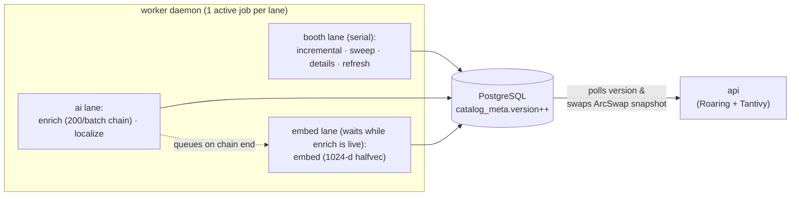

# Background jobs and AI enrichment

Reference for what the `worker` runs, when, and what the optional AI provider does for it. For the steps that set it up, see the [deployment guide](DEPLOY.md). Numbers are in [Measurements](MEASUREMENTS.md).

## Lanes

The worker groups jobs into three independent lanes, so polite serial BOOTH crawling never blocks AI enrichment or embedding. Each lane runs one job at a time.

`worker run` is the daemon. `worker once <kind> [params-json]` runs a single job. When a job changes the catalogue, `api` builds a new snapshot and swaps it in; the site stays up while it does.

## Schedule

`/admin` turns each schedule on and off. Every job below except `refresh` is scheduled by default (`refresh`'s default was not checked).

| Job | Lane | When | Does |
|---|---|---|---|
| `incremental` | booth | hourly | Fetches new items from BOOTH |
| `sweep` | booth | daily, 03:00 JST | Walks the full listing, updates prices, marks delisted items |
| `details` | booth | daily | Fetches missing galleries |
| `refresh` | booth | by schedule | Re-checks popular items |
| `enrich` | ai | hourly; does nothing until an AI provider is set | AI enrichment of items (below) |
| `localize` | ai | daily | Translates category, smart tag and BOOTH tag names (below) |
| `embed` | embed | hourly | Embeds items that lack a vector, then only new or edited ones |

## AI enrichment (optional)

Any OpenAI-compatible API works, with configurable reasoning effort. Without a provider, newly crawled items lack smart categories, avatar-fit links and translated titles.

`enrich` processes items in batches of 200 and chains itself until the backlog is empty. For each new item it:

- adds the smart categories, content rating and features;
- links the avatars the item fits, by name;
- translates the title into Chinese, English, Japanese and Korean.

Rules for translated titles:

- Avatar names stay as written.
- A title that drops an avatar name, adds a number, or uses another language's script gets one correction. If it still fails, it is not written.

An item that has failed 3 times is skipped (`items.enrich_failures`), until a crawl finds its title or description changed, which sets the count back to 0. A provider outage stops the batch without counting against any item. `/admin/jobs/given-up` lists the skipped items; Retry or Retry all sets their count to 0 and queues `enrich`. The overview's "Waiting for AI" tile says how many of its items were given up.

Pausing the schedule does not stop a chain that is already running. Cancel the active or queued `enrich` job in `/admin` to halt it at once.

## Tag and category translation (`localize`)

`localize` runs daily once an AI provider is set. Its first scheduled run comes a day after the migration.

- It translates the category and smart tag names that have no Chinese name into Chinese; the taxonomy carries its English, Japanese and Korean names.
- It translates the BOOTH tags that sit on 5 or more items and that the tag dictionary lacks into English, Japanese, Korean and Chinese, up to 400 a run (`max_tags`). Avatar names stay as written. It never changes a dictionary row.
- A value that fails its checks is left empty. A tag with no valid value, or whose answer names another tag, is asked again on later runs, 3 runs at most. After 3 runs without a valid translation, the tag is skipped until its row in `booth_tag_failures` is deleted.
- When an update changes the prompt that words the Chinese category and smart tag names, `api` queues `localize` with `force` at startup (and when the AI settings are saved). That run translates those names again and leaves the tag dictionary alone. The worker records the prompt's version (`app_settings` key `localize_state`) once the run has translated every name; a name the reply leaves out keeps its old wording, and the next start queues the run again.

## Semantic search vectors

Embeddings come from the same provider. The model must return 1024-dimension vectors through the `dimensions` parameter (for example `Qwen3-Embedding-4B`); the connection test in `/admin` verifies this.

- **Indexing:** the hourly `embed` job embeds items that lack a vector, then only new or edited items. Each time an `enrich` chain finishes it queues `embed`, so enriched items pick up their translated English titles without waiting for the hourly tick.
- **Query vectors:** each unseen query string makes one provider call. The vector is cached in memory and in `query_embeddings`, which holds text only (no user or session data). Unused entries are pruned after 90 days, and the table is capped at 50,000 entries. A repeated search takes milliseconds.
- **Related-search centroids:** `api` builds one centroid per BOOTH tag from every item vector at startup, and again at the first reload after 6 hours or after the worker records a new embeddings model (`app_settings` key `embed_state`). Other reloads reuse the centroids. A build streams every item vector from PostgreSQL. While the configured model differs from the one the centroids were built from, the related-search row stays hidden.
